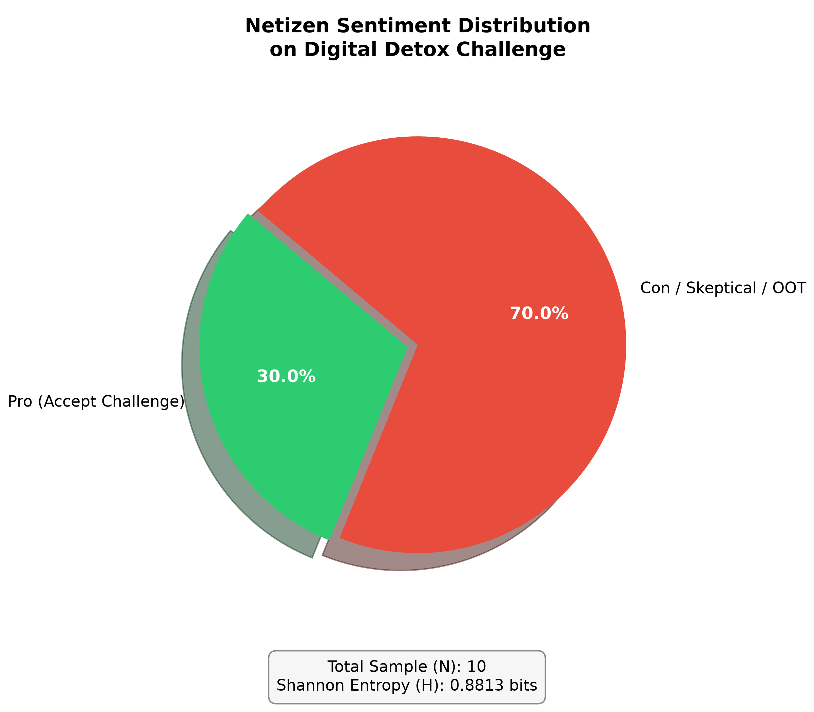

# MY FIRST SENTIMENT ANALYSIS EXPERIMENT: WHEN 70% OF COMMENT SENDERS REFUSE TO A "DIGITAL DETOX" CHALLENGE ON AN INSTAGRAM MENFESS

## Introduction
An end-to-end data science experiment exploring public sentiment dynamically perturbed by a "digital detox" challenge on anonymous student *menfess* platform feeds (Instagram). This project combines **Statistical Physics concepts (Shannon Entropy)**, **LLM Contextual Labeling (Gemini API)**, and **Deep Learning (Bi-LSTM)** to analyze social reactions.

---
## Inspiration
After I made my previous GitHub repo about catastrophic forgetting:

https://github.com/jovan-AIcoder/catastrophic-forgetting-experiment

Then this simple question crossed my mind: 

> How many doom-scrollers are actually around me? 

Driven by curiosity, I launched a social experiment on an anonymous menfess feed to capture real-time audience reactions and analyze the underlying statistics. 

And it works! This is my first ever sentiment analysis experiment, and it uses primary data too!

## 📌 Project Overview & Intent

The experiment introduces a specific perturbation (ragebait/clickbait prompt) into anonymous Instagram menfess feeds:
> *"Uninstall TikTok and use other social media under 15 minutes/day."*

The goal is to track response propagation, quantify response uncertainty using **Shannon Entropy**, label sentiment contextually via **Gemini API**, and attempt inference via a **Bi-LSTM Neural Network**. Also, **This project targets internet users at a university in Indonesia, who are students.**

---

## 📊 Key Findings & Results

Due to the rapid traffic velocity of student menfess feeds, posts undergo heavy signal attenuation (being quickly buried). A total sample of **$N = 10$ organic comments** was captured at equilibrium.

### 1. Sentiment Distribution & Shannon Entropy
* **Pro (Accept Challenge):** 30.0% (3 comments)
* **Con / Skeptical / OOT:** 70.0% (7 comments)
* **Shannon Entropy ($H$):** **$0.8813 \text{ bits}$** (out of $H_{\max} = 1.0 \text{ bit}$)

> **Insight:** The high entropy score ($0.8813 \text{ bits}$) indicates high disorder/uncertainty in public reaction, showing that the perturbation successfully generated diverse counter-arguments rather than immediate single-sided consensus.

### 2. Word Cloud Keyword Analysis
* **Pro Group:** Dominant keywords such as `"emang"`, `"tiktok"`, `"rasakan"`, and `"uninstall"` reflect real personal experiences of social media detachment.
* **Con / Skeptical Group:** Words like `"menit"`, `"youtube"`, `"jam"`, and `"harus"` highlight strong pushback against strict time limits (15 mins) and immediate platform substitution.

---

## 🛠️ Machine Learning Pipeline & Technical Lessons

The project pipeline consists of 4 main stages:

1. **Data Collection & Manual Extraction:** Collecting all comments data into `datasets/comments.csv`.
2. **Batch Labeling via Gemini API:** Automated zero-shot contextual labeling to classify subtle Indonesian slang and sarcasm into Pro (1) vs Con (0).
3. **Entropy & EDA Visualizations:** Generated distribution pie charts, ROC curves, confusion matrices, and comparative WordClouds.
4. **Bi-LSTM Training & Inference:** Trained a Keras Bidirectional LSTM using TensorFlow String Tensors (`tf.constant`).

## 🛡️ Data Privacy & Ethics (PII Compliance)

To strictly comply with **Data Privacy Principles** (e.g., preventing *Reverse Search / Exact String Matching* via search engines) and protect individual identities:
1. **PII Striping:** All `@mentions`, usernames, and specific personal entities were removed using Regex preprocessing (`re.sub(r'@\w+', '', text)`).
2. **LLM Paraphrasing:** All comments were paraphrased using the **Gemini API** (`gemini-3.8-flash`) prior to public repository release. This preserves the original semantic sentiment (Pro/Con tone) while preventing re-identification of original social media users.
3. **Raw Data Exclusion:** Raw scraped CSV files are excluded via `.gitignore`.

## ⚠️ Technical Study & Limitations: *Class Collapse on Small Sample*
During model training ($N=10$), the Bi-LSTM model exhibited **Majority Class Bias (Class Collapse)**, predicting all evaluation samples as Class 0 (probability ~0.46–0.47). 

* **Root Cause:** Deep Learning architectures require larger datasets ($N \ge 100+$) to effectively train recurrent layers and embedding vectors. With $N=10$ (70% Class 0), the optimizer minimizes loss most effectively by defaulting to the majority class.
* **Takeaway:** Demonstrates the necessity of traditional lightweight baseline models (e.g., Naive Bayes + TF-IDF) or Synthetic Data Augmentation when dealing with constrained pilot datasets.

---

## Author
Jovan, 2026

Licensed under MIT License.